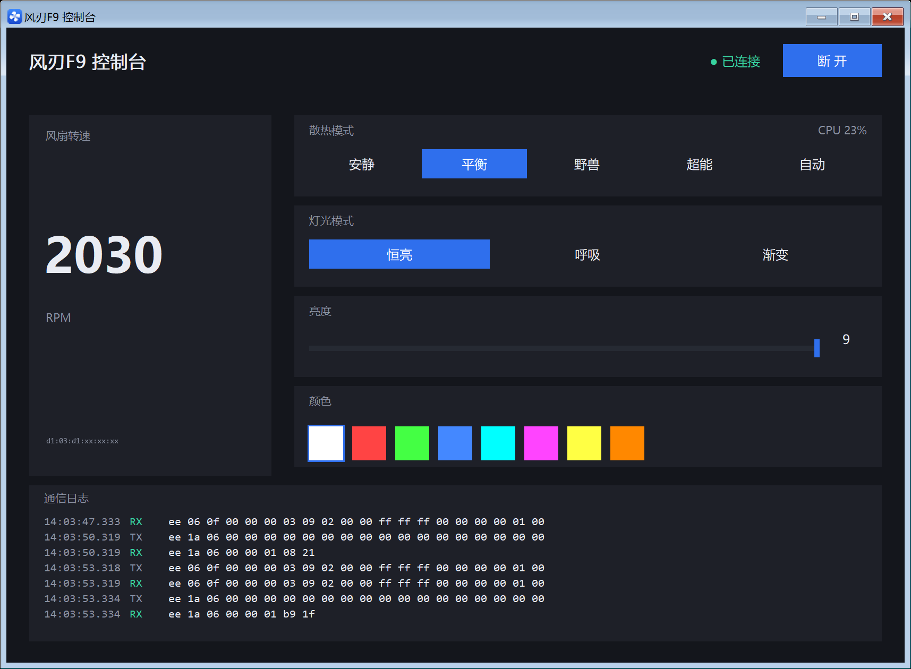

# 风刃 F9 蓝牙控制器

[](https://go.dev/)
[](LICENSE)
[](#运行要求)

联想「风刃 F9」（Lenovo `fan_F9` / 蓝牙名 `LEGION_F9_BT`、旧批次 `Viqsyx_F9_BT`）散热器的第三方控制工具。

原生 Win32 窗口、**无需安装官方程序**、**不加载任何内核驱动**、无 cgo、无第三方依赖，单个 exe 约 3.8 MB。



## 功能

- **散热**：安静 / 平衡 / 野兽 / 超能 四档，外加「自动」——按 CPU 占用率自动换档（官方是按温度的 App 端闭环，见[下文](#为什么自动模式用-cpu-占用率)）
- **灯光**：恒亮 / 呼吸 / 渐变，亮度 0–9，恒亮模式下可选 8 种颜色
- **实时转速**：每 3 秒轮询一次，直接显示在窗口里
- **托盘**：点 × 收进托盘继续跑；左键恢复窗口，右键菜单 `打开` / `开机启动` / `退出`
- **开机自启**：托盘菜单勾选即可（写 `HKCU` 的 Run 项，不需要管理员）
- **无副作用**：不监听端口、不装服务、不写系统目录，配置就在 exe 旁边

## 运行要求

- Windows 10 / 11（x64）
- 先在「设置 → 蓝牙和其他设备」里**配对散热器**（BLE 的 GATT 接口只对已配对设备开放）
- 运行前**退出官方 LEGION EDGE**（它会占着设备句柄）
- 官方 App 可以不装

## 快速开始

从 [Releases](https://github.com/iciness/fanf9ctl/releases) 下载 `fanf9ctl.exe`，双击即可：

程序启动后会自动连接名字里含 `F9_BT` 的设备，发握手、读一次当前配置，然后开始轮询转速。

```bat
fanf9ctl.exe            :: 打开窗口并自动连接
fanf9ctl.exe -debug     :: 同上，额外开一个日志控制台窗口
fanf9ctl.exe -tray      :: 只驻留托盘（开机自启用的就是这个）
fanf9ctl.exe -list      :: 列出系统里的 BLE 设备（排错第一步）
fanf9ctl.exe -diag      :: 逐步打印 GATT 枚举/读写/通知的 HRESULT（排错第二步）
fanf9ctl.exe -sim       :: 模拟模式，不碰硬件，只看界面
fanf9ctl.exe -device LEGION_F9_BT   :: 指定设备
```

程序编译成 **GUI 子系统**，双击不会有黑框；要看日志加 `-debug`，日志同时写 `fanf9ctl-ui.log`。

> 建议把整个文件夹放到桌面、`D:\Tools` 这类**普通目录**再运行。低完整性标签的目录（某些下载/沙箱目录）
> 会让进程处于 Low Integrity，受 UIPI 限制无法给 Explorer 的托盘窗口发消息，托盘图标会加不上。

## 命令行参数

| 参数 | 说明 |
|---|---|
| `-list` | 列出系统里已配对的 BLE 设备后退出 |
| `-diag` | 枚举 GATT 服务/特征，逐层打印读/写/订阅/通知的 HRESULT |
| `-sim` | 模拟设备，不访问蓝牙 |
| `-tray` | 启动后只驻留托盘，不显示窗口 |
| `-debug` | 打开日志控制台窗口 |
| `-device` | 覆盖设备名或地址 |
| `-config` | 指定配置文件路径（默认 exe 同目录 `config.json`） |

## 配置文件

`config.json` 与 exe 同目录，改完重启生效：

| 字段 | 说明 |
|---|---|
| `deviceName` | 设备名子串匹配，默认 `F9_BT`（同时覆盖 `LEGION_F9_BT` / `Viqsyx_F9_BT`） |
| `pollMs` / `reapplyMs` | 转速轮询 / 设置重发间隔 |
| `lightModes` | UI 索引 → 灯光字节，默认 `[3,2,1]` = 恒亮/呼吸/渐变 |
| `speeds` | UI 索引 → 档位字节，默认 `[0,1,2,3]` |
| `brightnessOffset` | 亮度在载荷里的偏移，默认 2 |

`state.json` 是程序自己写的行为记录（自动模式开关、档位、灯效、亮度），删掉就回到「按设备现状」。

## 协议与逆向结论

完整规格见 [`docs/PROTOCOL.md`](docs/PROTOCOL.md)，逆向过程与函数地址见 [`docs/REVERSE-NOTES.md`](docs/REVERSE-NOTES.md)，
报文样本统计见 [`docs/packets.md`](docs/packets.md)。要点：

- BLE 上是 **20 字节定长帧**：`EE | CMD | SUB | ARG16(LE) | DATA[15]`
- `06/0F` 写设置（设备原样回显当 ACK）、`05/0F` 读回配置、`1A/06` 状态轮询（回 8 字节，转速 = `LE16 >> 2`）
- 设置帧载荷：`[0]=Fanmode [1]=灯光模式 [2]=亮度 [3]=恒 2 [5]=多色标志 [6..8]=RGB [13]=档位`

### 三个踩过的坑

1. **必须打开按服务拆分的设备节点**

   打开 `\\?\BTHLE\Dev_<地址>` 这个总接口时，枚举能成功（读的是缓存），但所有真正走空中的操作
   （读值/写值/写 CCCD/注册通知）都返回 `HRESULT 0x80070001`。必须改开
   `\\?\BTHLEDevice\{服务UUID}_Dev_…` 节点才可以。代码里见 `ble_windows.go` 的 `ServicePaths()`。

2. **档位不在你以为的字节上**

   档位是 `data[13]`，灯光模式是 `data[1]`（`3=恒亮 2=呼吸 1=渐变`），亮度是 `data[2]`。
   早期把档位写到 `data[3]`、把灯模式写成 `0..3`，结果就是「档位没反应」外加「灯灭了」——
   因为 `data[1]=0` 其实是关灯。

3. **`data[0]=1` 会把档位锁死**

   官方帧里 `data[0]` 恒为 0；写成 1 之后四个档位的转速都卡在 2031 转，且重启后仍留在设备里。
   本工具每次连接都会把它回写成 0。

### 为什么「自动」模式用 CPU 占用率

官方 App 的 AI 模式**不是**设备端功能：跑起来抓帧可以看到它每 1–2 秒改一次档位字节、
`data[0]` 始终是 0 —— 是 App 自己读 CPU 温度、按曲线选档再下发。

而 F9 本身没有温度传感器，官方也从不把温度发给设备。要在本工具里复刻同样的闭环就得读 CPU 温度，
那需要 `LEGION EDGE.sys` / WinRing0 这类内核驱动（有已知的任意物理内存读写漏洞，在微软的
易受攻击驱动名单里）。本项目**不加载任何内核驱动**，所以改用 `GetSystemTimes` 得到的 CPU 占用率近似：
每 2 秒采样、取 3 拍均值、上下行带回差，一次只走一档。实测空载落 1 档（约 2030 转）、
满载升到 3 档（约 3050 转）、卸载后回落。

## 已知限制

| 限制 | 说明 |
|---|---|
| 不显示电脑温度 | 不装驱动就读不到 CPU 温度（本机 ACPI 热区也不可用） |
| 「自动」不是按温度 | 用 CPU 占用率近似，比温度曲线更跟手，但没有热惯性延迟 |
| 呼吸 / 渐变的配色不可调 | 由设备自己变化，官方 App 里同样调不了 |
| 动态光效未实现 | 没有抓到对应样本，界面上只放了三种灯效 |
| 无驱动、无管理员 | 托盘图标在低完整性目录下会失败（见上文提示） |

## 排错

| 现象 | 处理 |
|---|---|
| `-list` 里没有设备 | 没配对或没开蓝牙，先去系统设置里配对 |
| 连接失败 `CreateFile` | 官方 LEGION EDGE 占着句柄，退出它 |
| 读/写全报 `HRESULT 0x80070001` | 打开的是总接口，应该用按服务拆分的节点（本工具已处理，`-diag` 可确认） |
| 连上了但转速一直是 `--` | 通知特征没订阅上，`-diag` 看 `[4] 写 CCCD` / `[5] RegisterEvent` |
| 托盘图标加不上 | 从普通目录运行；或者被安全软件拦了，日志在 `fanf9ctl-ui.log` |
| 设置没反应 | 设备对设置帧是「回显即成功」，回显内容不一致说明拒绝了这组参数 |

更细的真机记录见 [`docs/MIGRATION.md`](docs/MIGRATION.md)。

## 目录结构

```
.
├── main.go              启动流程、命令行
├── controller.go        连接、轮询、重发、自动换档、日志
├── protocol.go          帧构造/解析（纯逻辑）
├── protocol_test.go     用实机抓到的帧做回归测试
├── config.go / state.go 配置与本地状态
├── ble_windows.go       Win32 BluetoothGATT 封装（结构体对照 bthledef.h）
├── gui_windows.go       原生界面：建窗、GDI 自绘、托盘、命中测试
├── icon_windows.go      图标加载
├── autostart_windows.go 开机启动（HKCU Run）
├── cpuload_windows.go   CPU 占用率采样
├── console_windows.go   控制台窗口（-debug）
├── diag_windows.go      -diag
├── sim.go               模拟设备
├── icon.ico             图标（运行时嵌入）
├── rsrc_windows_amd64.syso  exe 文件图标的 PE 资源
├── docs/                协议、逆向笔记、报文样本、真机记录、截图
└── tools/               图标生成脚本
```

`*_other.go` 是非 Windows 的占位实现，方便在别的平台上跑测试。

## 构建

需要 Go 1.21+（无 cgo、无第三方依赖）：

```bat
build.bat
```

或者手动：

```bat
go build -trimpath -ldflags "-s -w -H windowsgui" -o fanf9ctl.exe .
```

`-H windowsgui` 让程序成为 GUI 子系统（双击无黑框）。`rsrc_windows_amd64.syso` 提供 exe 文件图标，
`icon.ico` 用 `go:embed` 嵌进二进制供窗口和托盘使用。换图标见 `tools/` 里的脚本。

## 贡献

欢迎提 Issue / PR。注意两点：

- 涉及协议字段的改动，请附上实机抓到的帧（官方 App 的 `%LOCALAPPDATA%\LEGION EDGE\BleC.log` 或本工具的 `-debug` 日志）
- 不要提交任何官方程序的二进制、资源文件或运行日志

## 许可证

[MIT](LICENSE)

## 声明

本项目仅用于**自己拥有的硬件**的互操作性研究。协议信息来自对公开安装的官方程序的静态分析与
其自身产生的日志，不包含官方任何代码或资源文件；界面为重新绘制，非官方素材。

「Lenovo」「LEGION」是联想公司的商标，本项目与联想无任何关联，也未获其认可。
使用本软件造成的任何问题由使用者自行承担。
